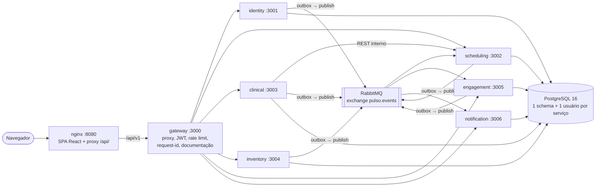

# Pulso

> **Doe sangue. Mantenha a vida pulsando.**

[](https://github.com/LabdoGui/Aplicativo-Refer-ncia-Pou-/actions/workflows/ci.yml)

O **Pulso** é uma plataforma web responsiva (PWA) de apoio à doação de sangue. Ela acompanha a jornada de quem doa (descoberta, cadastro, pré-triagem informativa, agendamento, lembretes, atendimento, pós-doação e incentivo à recorrência) e oferece à equipe de coleta e à gestão ferramentas para organizar a agenda, registrar o atendimento e acompanhar o estoque de sangue.

Projeto **acadêmico**, desenvolvido com **dados fictícios**. Não substitui o sistema de um hemocentro nem decide quem pode doar.

---

## Sumário

- [Objetivo](#objetivo)
- [ODS 3 — Saúde e Bem-Estar](#ods-3--saúde-e-bem-estar)
- [Status do desenvolvimento](#status-do-desenvolvimento)
- [Arquitetura](#arquitetura)
- [Tecnologias](#tecnologias)
- [Requisitos](#requisitos)
- [Como executar](#como-executar)
- [Desenvolvimento local](#desenvolvimento-local)
- [Configuração](#configuração)
- [Banco de dados](#banco-de-dados)
- [Contas de demonstração](#contas-de-demonstração)
- [Documentação da API](#documentação-da-api)
- [Estrutura do projeto](#estrutura-do-projeto)
- [LGPD e dados fictícios](#lgpd-e-dados-fictícios)
- [Documentação do projeto](#documentação-do-projeto)

---

## Objetivo

Aumentar a **recorrência** e a **organização** da doação de sangue com uma experiência digital única para três públicos:

| Perfil | O que faz no sistema |
|---|---|
| **Doador** | Cadastro, pré-triagem informativa, agendamento, histórico, notificações, conquistas, horas complementares e comprovantes |
| **Equipe** (colaborador e enfermeiro) | Agenda do dia, check-in, triagem presencial e registro da doação |
| **Administração** | Usuários, unidades, horários, campanhas, estoque, gamificação, relatórios e auditoria |

O problema, as personas e os requisitos estão detalhados em [docs/01](docs/01-visao-geral-problema-ods.md), [docs/02](docs/02-personas-e-jornada.md) e [docs/03](docs/03-requisitos.md).

## ODS 3 — Saúde e Bem-Estar

O projeto se alinha ao **Objetivo de Desenvolvimento Sustentável 3** da ONU: assegurar uma vida saudável e promover o bem-estar para todos. A disponibilidade de sangue depende de doadores regulares; o Pulso ataca as barreiras de informação, agendamento e lembrete que fazem a pessoa não voltar a doar. A justificativa completa está em [docs/01](docs/01-visao-geral-problema-ods.md).

## Status do desenvolvimento

O desenvolvimento segue as 14 fases do [plano de implementação](docs/16-plano-de-implementacao.md#8-roadmap-de-implementação). Cada fase tem um critério de pronto verificável.

| Fase | Entrega | Status |
|---|---|---|
| 1 | Arquitetura e estrutura: monorepo, bibliotecas comuns, 6 serviços e gateway com health e Swagger, frontend com layouts e página de status, Docker Compose e CI | **Concluída** |
| 2 | Banco (Prisma e migrações de todos os schemas), autenticação (cadastro, login, refresh, RBAC), outbox e eventos | Planejada |
| 3 | Cadastro, perfil, consentimento e privacidade | Planejada |
| 4 | Pré-triagem em 6 etapas com regras no back-end | Planejada |
| 5 | Unidades, grade, disponibilidade, agendamento, cancelamento e reagendamento | Planejada |
| 6 | Área da equipe: agenda do dia, check-in e triagem configurável | Planejada |
| 7 | Registro da doação e eventos | Planejada |
| 8 | Gamificação e horas complementares | Planejada |
| 9 | Comprovante em PDF e verificação pública | Planejada |
| 10 | Dashboard administrativo e relatórios com filtros | Planejada |
| 11 | Estoque ("Banco de Sangue") e movimentações | Planejada |
| 12 | Central de notificações | Planejada |
| 13 | Segurança e testes (E2E da jornada, autorização, carga) | Planejada |
| 14 | Polimento visual e acessibilidade | Planejada |

Nesta fase os serviços ainda não têm regras de negócio: eles sobem, conectam ao banco e ao broker, expõem `/health` e a documentação Swagger.

## Arquitetura

Microsserviços com **API Gateway**, **um schema PostgreSQL por serviço** e **eventos assíncronos** no RabbitMQ. O nginx serve a SPA e encaminha `/api/` ao gateway, então navegador e API compartilham a mesma origem.



| Componente | Porta | Responsabilidade |
|---|---|---|
| `frontend` (nginx) | 8080 | SPA React (doador, equipe e administração); proxy de `/api/` para o gateway; cabeçalhos de segurança |
| `gateway` | 3000 | Entrada única da API: roteamento por prefixo, validação de JWT, rate limit, `x-request-id`, CORS, estado dos serviços e documentação unificada |
| `identity` | 3001 | Contas, autenticação (JWT RS256 + JWKS), perfis de doador e profissional, consentimentos (LGPD) |
| `scheduling` | 3002 | Unidades, grade de horários, vagas, agendamentos e campanhas |
| `clinical` | 3003 | Pré-triagem, triagem presencial, doações e comprovantes (todos os dados de saúde em um só lugar) |
| `inventory` | 3004 | Estoque central de sangue e movimentações (sem dados pessoais) |
| `engagement` | 3005 | Pontos, níveis, conquistas, ranking e horas complementares (consumidor de eventos) |
| `notification` | 3006 | Central de notificações (consumidor de eventos) |
| `postgres` | 5432 | PostgreSQL 16: um schema e um usuário por serviço |
| `rabbitmq` | 5672 / 15672 | Broker de eventos (exchange *topic* `pulso.events`) e painel de gestão |

Por que 6 serviços e não 11, como os eventos fluem e as decisões tomadas: [docs/16](docs/16-plano-de-implementacao.md) e [docs/06](docs/06-arquitetura.md).

## Tecnologias

| Camada | Tecnologias |
|---|---|
| Frontend | React 19, TypeScript, Vite 7, Tailwind CSS 4, React Router 7, TanStack Query 5, React Hook Form + Zod, Recharts, lucide-react |
| Back-end | Node.js 22, NestJS 11, TypeScript 5.9, npm workspaces (monorepo) |
| Dados | PostgreSQL 16, Prisma 6 (um `schema.prisma` por serviço) |
| Mensageria | RabbitMQ 3.13 (`amqplib` + `amqp-connection-manager`) |
| Segurança | `jose` (JWT RS256 + JWKS), Argon2id (`@node-rs/argon2`), helmet, AES-256-GCM para campos sensíveis |
| Observabilidade | Logs JSON com `nestjs-pino` e `x-request-id` de ponta a ponta |
| Documentação | `@nestjs/swagger` (OpenAPI) em cada serviço, unificada no gateway |
| Testes | Jest + ts-jest; smoke test do ambiente (`scripts/smoke.mjs`) |
| Infraestrutura | Docker, Docker Compose, nginx, GitHub Actions |

## Requisitos

- **Docker** com **Docker Compose v2** (`docker compose version`) — para rodar tudo em contêineres.
- **Node.js 22** e npm 10 — só para desenvolvimento local (a versão está em `.nvmrc`).
- Livres no computador: porta **8080** e, só em `127.0.0.1`, as portas 3000–3006, 5432, 5672 e 15672.

## Como executar

```bash
git clone https://github.com/LabdoGui/Aplicativo-Refer-ncia-Pou-.git pulso
cd pulso
docker compose up --build
```

Não é preciso criar o `.env`: todas as variáveis têm valores padrão de desenvolvimento. O primeiro build baixa as dependências e leva alguns minutos; os seguintes usam o cache.

| O quê | Endereço |
|---|---|
| Aplicação | <http://localhost:8080> |
| Página de status dos serviços | <http://localhost:8080/status> |
| Documentação da API (Swagger unificado) | <http://localhost:8080/api/docs> |
| Estado dos serviços (JSON) | <http://localhost:8080/api/v1/health/services> |
| Painel do RabbitMQ (usuário `pulso`, senha `pulso_dev`) | <http://localhost:15672> |
| Swagger de cada serviço (depuração) | `http://localhost:3001/docs` … `http://localhost:3006/docs` |

Para conferir se tudo subiu (frontend, gateway, 6 serviços, banco, broker e documentação):

```bash
npm run smoke          # ou: node scripts/smoke.mjs
```

O smoke test só usa o Node 22 (sem dependências) e espera até 120 s o ambiente ficar pronto (`--timeout=180` para mudar; `BASE_URL` para outro endereço).

Comandos úteis:

```bash
docker compose ps                 # estado e saúde dos contêineres
docker compose logs -f gateway    # logs de um serviço
docker compose down               # para tudo (os dados ficam nos volumes)
docker compose down -v            # para tudo e APAGA banco e broker
```

**Limite de downloads do Docker Hub?** Copie o `.env.example` para `.env` e troque as imagens base por um espelho, por exemplo `NODE_IMAGE=mirror.gcr.io/library/node:22-alpine` (o mesmo vale para `NGINX_IMAGE`, `POSTGRES_IMAGE` e `RABBITMQ_IMAGE`).

## Desenvolvimento local

Para programar com recarga rápida, rode banco e broker no Docker e os processos Node no seu computador:

```bash
npm ci                             # dependências de todos os workspaces
npm run infra:up                   # só PostgreSQL e RabbitMQ (docker compose)
npm run build                      # bibliotecas, serviços (prisma generate) e gateway
npm run dev:backend                # sobe os 6 serviços + gateway a partir de dist/
npm run dev -w @pulso/frontend     # frontend em http://localhost:5173 (proxy de /api para o gateway)
```

O `scripts/dev-backend.mjs` inicia cada processo com as variáveis corretas (as mesmas do `docker-compose.yml`, apontando para `localhost`), mostra os logs com um prefixo colorido por serviço e encerra todos com **Ctrl+C**. Para subir só alguns: `npm run dev:backend -- --only=identity,gateway`. Depois de alterar um serviço, recompile-o (`npm run build -w @pulso/identity-service`) e reinicie o script.

Outros comandos:

| Comando | O que faz |
|---|---|
| `npm test` | Testes unitários (Jest) de todos os workspaces |
| `npm run typecheck` | Checagem de tipos sem gerar arquivos |
| `npm run format` / `npm run format:check` | Formata / confere a formatação (Prettier) |
| `npm run infra:down` | Para os contêineres do Compose |
| `npm run docker:up` / `docker:down` | Sobe (com build) / derruba o ambiente completo em contêineres |
| `npm run docker:reset` | Derruba tudo e **apaga** os volumes (banco e broker) |

## Configuração

As variáveis estão documentadas no [`.env.example`](.env.example), com os mesmos valores padrão do `docker-compose.yml`. Para mudar algo, copie para `.env` e edite. As marcadas com **[SEGREDO]** precisam ser trocadas fora do ambiente acadêmico.

| Variável | Para quê |
|---|---|
| `POSTGRES_USER`, `POSTGRES_PASSWORD`, `POSTGRES_DB` | Superusuário e banco do PostgreSQL |
| `<SERVIÇO>_DB_PASSWORD` | Senha do usuário de cada schema (aplicada na criação do volume) |
| `RABBITMQ_USER`, `RABBITMQ_PASSWORD` | Credenciais do broker |
| `INTERNAL_API_TOKEN` | Token das rotas `/internal/*` entre serviços |
| `LOG_LEVEL` | Nível dos logs JSON |
| `CORS_ORIGINS`, `RATE_LIMIT_*` | Políticas de borda do gateway |
| `FRONTEND_PORT`, `GATEWAY_PORT`, `POSTGRES_PORT`, `RABBITMQ_PORT`, `RABBITMQ_UI_PORT` | Portas publicadas no computador |
| `NODE_IMAGE`, `NGINX_IMAGE`, `POSTGRES_IMAGE`, `RABBITMQ_IMAGE` | Imagens base (para usar um espelho) |

Cada processo valida as próprias variáveis na inicialização (Zod) e não sobe se faltar alguma, com uma mensagem clara no log.

## Banco de dados

Uma instância PostgreSQL 16 com **um schema e um usuário por serviço**. Cada serviço só enxerga o próprio schema; entre serviços, apenas UUIDs (nunca chaves estrangeiras).

| Schema | Usuário | Serviço |
|---|---|---|
| `identity` | `identity_app` | identity |
| `scheduling` | `scheduling_app` | scheduling |
| `clinical` | `clinical_app` | clinical |
| `inventory` | `inventory_app` | inventory |
| `engagement` | `engagement_app` | engagement |
| `notification` | `notification_app` | notification |

Os schemas e usuários são criados por [`database/init/01-init.sh`](database/init/01-init.sh) na **primeira** inicialização do volume `pgdata`. Para recriá-los (por exemplo, depois de mudar uma senha), use `docker compose down -v`, que apaga os dados.

**Migrações e dados de exemplo** (seed fictício e determinístico) chegam na **Fase 2**. O modelo de dados planejado está em [docs/16, item 5](docs/16-plano-de-implementacao.md#5-modelo-do-banco-por-schema) e [docs/07](docs/07-banco-de-dados.md).

## Contas de demonstração

Disponíveis a partir das Fases 2 e 3, quando entram a autenticação e o seed:

| Perfil | E-mail |
|---|---|
| Administrador | `admin@demo.com` |
| Enfermeiro | `enfermeiro@demo.com` |
| Doador | `doador@demo.com` |

A senha será documentada aqui quando o seed existir. São contas fictícias, apenas para demonstração.

## Documentação da API

- **Swagger unificado:** <http://localhost:8080/api/docs> (OpenAPI em <http://localhost:8080/api/docs-json>). O gateway reúne a documentação de todos os serviços.
- **Swagger de cada serviço:** `http://localhost:<porta>/docs` (portas 3001 a 3006, só em `127.0.0.1`).
- **Prefixo:** todas as rotas públicas ficam em `/api/v1`; rotas `/internal/*` nunca passam pelo gateway.
- **Erros:** padrão RFC 9457 (`application/problem+json`) com mensagem em português e `requestId` para suporte.
- **Rastreamento:** o cabeçalho `x-request-id` é aceito ou gerado na borda e acompanha a requisição em todos os logs.

O desenho completo da API está em [docs/09](docs/09-api.md) e [docs/16, item 4](docs/16-plano-de-implementacao.md#4-microsserviços-responsabilidades-e-endpoints).

## Estrutura do projeto

```
/
├─ frontend/                 React + Vite (doador, equipe e administração)
├─ backend/
│  ├─ gateway/               NestJS: proxy, segurança de borda, estado dos serviços, documentação
│  ├─ services/
│  │  ├─ identity/           NestJS + Prisma (schema identity)
│  │  ├─ scheduling/
│  │  ├─ clinical/
│  │  ├─ inventory/
│  │  ├─ engagement/
│  │  └─ notification/
│  └─ libs/
│     ├─ contracts/          @pulso/contracts: tipos, enums, papéis e eventos (front e back)
│     └─ common/             @pulso/common: bootstrap, configuração, logs, auth, erros, saúde, mensageria
├─ database/init/            criação de schemas e usuários por serviço
├─ docker/                   service.Dockerfile (imagem única dos processos Nest), frontend.Dockerfile, nginx.conf
├─ scripts/                  smoke.mjs (smoke test) e dev-backend.mjs (back-end local)
├─ docs/                     documentação acadêmica e técnica
├─ .github/workflows/ci.yml  build, testes, imagens Docker e smoke test
├─ docker-compose.yml
└─ package.json              npm workspaces
```

## LGPD e dados fictícios

- **Nenhum dado real** é usado: doadores, triagens, doações, estoques e instituições são **fictícios**. Não cadastre dados pessoais verdadeiros no ambiente de demonstração.
- A **pré-triagem é informativa**: orienta, mas nunca libera nem bloqueia a doação. A decisão é sempre da equipe de saúde do hemocentro.
- A **triagem presencial** e o **estoque** são **simulação acadêmica**. Pelo desenho, as regras clínicas ficarão em tabelas configuráveis, marcadas como pendentes de validação por profissional de saúde (nenhuma regra médica é inventada pelo sistema).
- O comprovante gerado é **acadêmico e verificável**; não é o atestado oficial de doação.
- Pelo desenho, os dados de saúde ficam concentrados no serviço `clinical`, com campos sensíveis cifrados, consentimento por finalidade e auditoria de acesso (implementados a partir das Fases 2 a 4). Detalhes em [docs/10](docs/10-seguranca-lgpd.md).
- Os segredos do `.env.example` e do `docker-compose.yml` são públicos e servem só para desenvolvimento.

## Documentação do projeto

| # | Documento |
|---|---|
| 01 | [Visão geral, problema e ODS 3](docs/01-visao-geral-problema-ods.md) |
| 02 | [Público-alvo, personas e jornada do doador](docs/02-personas-e-jornada.md) |
| 03 | [Requisitos e regras de negócio](docs/03-requisitos.md) |
| 04 | [Casos de uso](docs/04-casos-de-uso.md) |
| 05 | [Fluxos](docs/05-fluxos.md) |
| 06 | [Arquitetura: microsserviços + API REST](docs/06-arquitetura.md) |
| 07 | [Banco de dados](docs/07-banco-de-dados.md) |
| 08 | [Stack tecnológica](docs/08-stack.md) |
| 09 | [API REST v1](docs/09-api.md) |
| 10 | [Segurança e LGPD](docs/10-seguranca-lgpd.md) |
| 11 | [Pesquisa, benchmarking e dados públicos](docs/11-pesquisa-benchmarking.md) |
| 12 | [Identidade visual](docs/12-identidade-visual.md) |
| 13 | [MVP e roadmap](docs/13-mvp-roadmap.md) |
| 14 | [Riscos, diferenciais e recomendações](docs/14-riscos-diferenciais-recomendacoes.md) |
| 15 | [Roteiro do Checkpoint 1](docs/15-checkpoint-1.md) |
| 16 | [Plano de implementação](docs/16-plano-de-implementacao.md) (especificação técnica de referência) |
| — | [Referências verificadas](docs/referencias.md) |

Os documentos 01 a 15 formam a proposta do Checkpoint 1 (com stack Spring Boot); o documento 16 registra o que mudou na implementação (NestJS + Prisma, 4 papéis fixos, estoque central). Os documentos usam etiquetas para separar fatos de hipóteses:

| Etiqueta | Significado |
|---|---|
| **[FONTE]** | Informação com origem verificável, listada em [referencias.md](docs/referencias.md) |
| **[HIPÓTESE]** | Suposição do grupo, a confirmar em pesquisa de campo ou com a instituição parceira |
| **[VALIDAR-SAÚDE]** | Depende de legislação, protocolo de hemoterapia ou decisão de profissional de saúde |
| **[VALIDAR-JURÍDICO]** | Depende de análise jurídica, LGPD, validade documental ou convênio |
| **[SIMULAÇÃO]** | Existe apenas para demonstração acadêmica, com dados fictícios |
