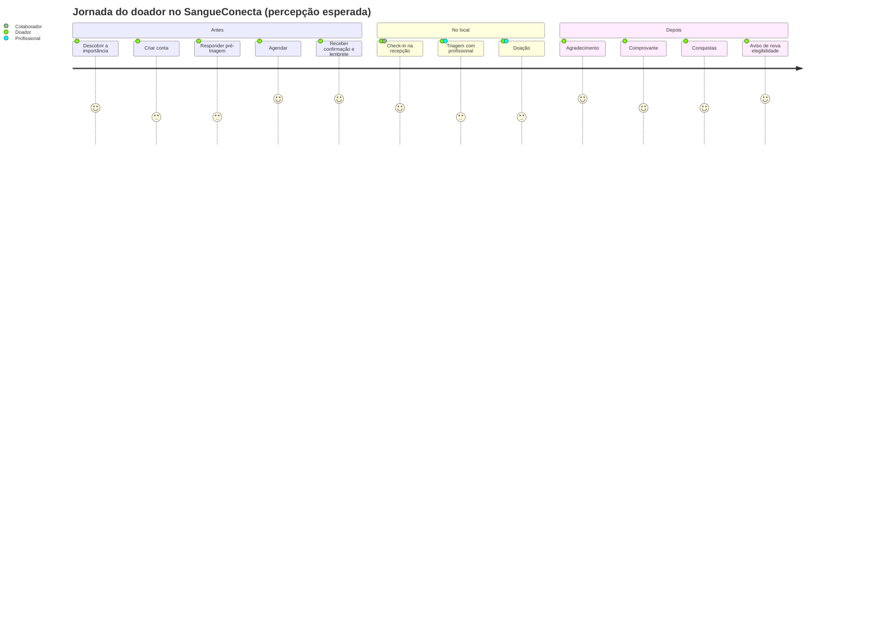

# 02 — Público-alvo, personas e jornada do doador

## PARTE 4 — Público-alvo e personas

### 4.1 Segmentos

| Segmento | Perfil no sistema | Prioridade no MVP |
|----------|-------------------|-------------------|
| Potenciais doadores (primeira doação), principalmente estudantes universitários | DOADOR | Alta |
| Doadores recorrentes | DOADOR | Alta |
| Recepção / apoio da unidade de coleta | COLABORADOR | Média |
| Profissional de saúde responsável pela triagem | PROFISSIONAL_TRIAGEM | Alta (como [SIMULAÇÃO]) |
| Gestão da unidade / estoque | ADMIN_UNIDADE, GESTOR_ESTOQUE | Alta |
| Instituição de ensino parceira (horas complementares) | INSTITUICAO_ENSINO | Versão 2 |

> Os perfis foram nomeados **pela função, não pela profissão**. Usar "PROFISSIONAL_TRIAGEM" em vez de "ENFERMEIRO" evita gravar no código quem pode fazer triagem, porque isso é definido pela regulamentação e pela instituição [VALIDAR-SAÚDE].

### 4.2 Personas

Todas são **fictícias** [HIPÓTESE] e devem ser revisadas após as entrevistas de campo.

---

#### Persona 1 — Ana Luísa, 20 anos, estudante de Engenharia (primeira doação)

- **Contexto:** mora longe do hemocentro, usa o celular para tudo e tem a agenda de aulas variável.
- **Motivação:** quer ajudar e soube que a faculdade *talvez* aceite horas complementares.
- **Barreiras:** medo de agulha; não sabe se a tatuagem recente impede a doação; não sabe onde nem quando doar.
- **Precisa de:** explicação simples do processo, pré-triagem rápida, agendamento em poucos toques, lembrete na véspera.
- **Frase:** *"Eu doaria se soubesse que posso e se não perdesse a manhã inteira na fila."*

#### Persona 2 — Carlos, 38 anos, analista administrativo CLT (doador recorrente)

- **Contexto:** já doou 4 vezes, sempre em campanhas da empresa.
- **Motivação:** sente que faz diferença e usa o direito de ausência previsto na CLT (art. 473, IV) [FONTE].
- **Barreiras:** esquece quando pode doar de novo; perde o comprovante de papel.
- **Precisa de:** histórico, aviso de "você já pode doar novamente" (a regra de intervalo é [VALIDAR-SAÚDE]), comprovante digital.
- **Frase:** *"Se o aplicativo me avisasse a data certa, eu doaria todo ano sem pensar."*

#### Persona 3 — Seu Roberto, 66 anos, aposentado (doador de longa data)

- **Contexto:** doa há mais de 20 anos e acompanhou notícias sobre mudanças nas regras em 2026 [FONTE, imprensa].
- **Barreiras:** letras pequenas, formulários longos, desconfiança de aplicativos.
- **Precisa de:** acessibilidade (fonte ampliável, alto contraste), linguagem clara, possibilidade de ligar para a unidade.
- **Frase:** *"Quero saber se ainda posso doar sem ter que ler um texto jurídico."*

#### Persona 4 — Juliana, 34 anos, profissional de saúde da unidade de coleta

- **Contexto:** faz dezenas de triagens por turno usando o sistema oficial da instituição.
- **Barreiras:** não aceita digitar a mesma informação em dois sistemas; precisa de agilidade.
- **Precisa de:** agenda do dia, confirmação de quem chegou, acesso rápido ao que o doador declarou antes (se a instituição permitir) e registro mínimo do desfecho.
- **Frase:** *"Qualquer sistema novo precisa me poupar tempo, não me dar mais trabalho."*
- **Implicação de projeto:** esta persona justifica tratar o módulo de triagem como [SIMULAÇÃO] no protótipo e propor **integração** no futuro, em vez de substituir o sistema oficial.

#### Persona 5 — Marcos, 27 anos, recepção / colaborador

- **Precisa de:** lista do dia por horário, busca por nome ou código do agendamento, botão de check-in, registro de quem chegou sem agendar (espontâneo).

#### Persona 6 — Paula, 47 anos, coordenadora da unidade e da gestão de estoque

- **Contexto:** planeja campanhas e responde quando um tipo sanguíneo fica crítico.
- **Precisa de:** painel com situação por tipo, tendência, faltas e cancelamentos, configuração de horários e capacidade.
- **Frase:** *"Preciso saber hoje que o O- vai faltar na semana que vem, não depois."*

---

## PARTE 5 — Jornada completa do doador

### 5.1 Visão geral

### 5.2 Etapas detalhadas

| Etapa | Objetivo do doador | O que o sistema faz | Serviço responsável | Dores / riscos | Etiquetas |
|---|---|---|---|---|---|
| **1. Descoberta** | Entender por que, como e onde doar | Página pública: importância, passo a passo, requisitos básicos, mitos e verdades, locais | Frontend (conteúdo estático) | Informação desatualizada após mudança normativa | Conteúdo clínico [VALIDAR-SAÚDE] |
| **2. Cadastro** | Criar conta rapidamente | Coleta mínima: nome, e-mail, telefone (opcional), data de nascimento, senha e aceite da política de privacidade. Consentimentos separados por finalidade (notificações, uso de dados de saúde) | identity-service | Excesso de campos; CPF real no protótipo | CPF **não** coletado no protótipo; menores de 18 fora do MVP [VALIDAR-JURÍDICO] |
| **3. Pré-triagem** | Saber se "parece poder" doar | Questionário versionado; motor de regras devolve **PODE_PROSSEGUIR**, **CONVERSAR_COM_UNIDADE** ou **AGUARDAR** (com data informativa), sempre com o aviso de que a decisão final é do profissional | clinical-service | Falso "pode doar" ou falsa exclusão | Regras [VALIDAR-SAÚDE]; respostas são dado sensível |
| **4. Agendamento** | Escolher local, data e hora | Lista vagas reais (capacidade − ocupação), impede conflito, capacidade excedida e mais de um agendamento ativo (configurável) | scheduling-service | Corrida por vagas; agendar antes do intervalo mínimo | Intervalo [VALIDAR-SAÚDE] |
| **5. Confirmação** | Ter certeza do horário | Tela de sucesso, código do agendamento, e-mail com orientações de preparo, opção de adicionar ao calendário (.ics) | scheduling + notification | E-mail na caixa de spam | Orientações de preparo [VALIDAR-SAÚDE] |
| **6. Lembrete** | Não esquecer | Lembrete configurável (ex.: 24 h antes) com botões "Confirmo" e "Preciso remarcar" | scheduling (agendador) + notification | Excesso de mensagens | Antecedência [HIPÓTESE] |
| **7. Atendimento presencial** | Ser recebido sem atrito | Colaborador faz o check-in pelo código ou nome; espontâneos também são registrados | scheduling-service | Documento com foto é exigido pela unidade | — |
| **8. Triagem profissional** | Ser avaliado | Profissional vê o agendamento e, se autorizado, a pré-triagem; registra o resultado (APTO / NÃO APTO) e observações restritas | clinical-service | Duplicidade com o sistema oficial | **[SIMULAÇÃO]** no protótipo |
| **9. Doação** | Doar com segurança | Profissional registra "doação concluída" ou "não concluída" (motivo categorizado e não clínico) | clinical-service | — | **[SIMULAÇÃO]** |
| **10. Pós-doação** | Sentir que fez diferença | Mensagem de agradecimento e orientações pós-doação | notification | Tom genérico | Orientações [VALIDAR-SAÚDE]; mensagem inspirada em Gemelli et al. (2018) [FONTE] |
| **11. Documento** | Comprovar a doação ou o comparecimento | **Comprovante acadêmico** em PDF com código e QR de verificação; download autenticado; link de verificação com prazo de expiração | clinical-service (módulo de documentos) | Ser confundido com atestado oficial | [VALIDAR-JURÍDICO]; marca d'água "documento acadêmico" |
| **12. Gamificação** | Ver o próprio progresso | Pontos de **comparecimento** (independentem do resultado clínico), conquistas e nível | engagement-service | Pressão para doar; incentivo a omitir informação | Ver regras éticas em [03-requisitos](03-requisitos.md) |
| **13. Próxima doação** | Saber quando pode voltar | Data **informativa** calculada pelo conjunto de regras vigente; notificação quando chegar a data. Se o desfecho indicar que o doador não deve ser convidado, os lembretes são suspensos **sem expor o motivo** | clinical-service → evento → scheduling + notification | Regra desatualizada | [VALIDAR-SAÚDE] |

### 5.3 Momentos críticos de experiência

1. **Resultado da pré-triagem:** a linguagem precisa ser cuidadosa. Nunca usar "você está apto" ou "você está inapto". Exemplos de texto:
   - *"Pelas suas respostas, você parece atender aos critérios básicos. A confirmação acontece na triagem com o profissional de saúde."*
   - *"Algumas respostas precisam ser avaliadas pela equipe. Recomendamos falar com a unidade antes de agendar."*
2. **Não ter sido considerado apto no local:** o sistema não mostra o motivo. A comunicação é feita pelo profissional, pessoalmente [VALIDAR-SAÚDE]. A mensagem automática é neutra e agradece o comparecimento.
3. **Comprovante:** deixar explícito o que o documento comprova e o que não comprova.
