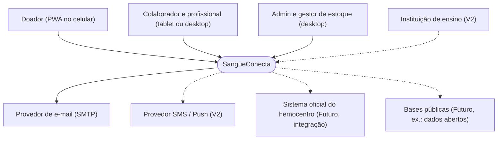
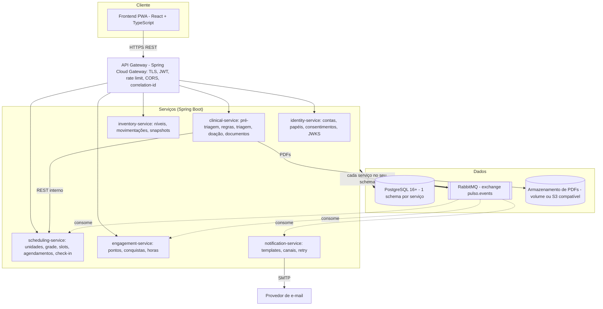
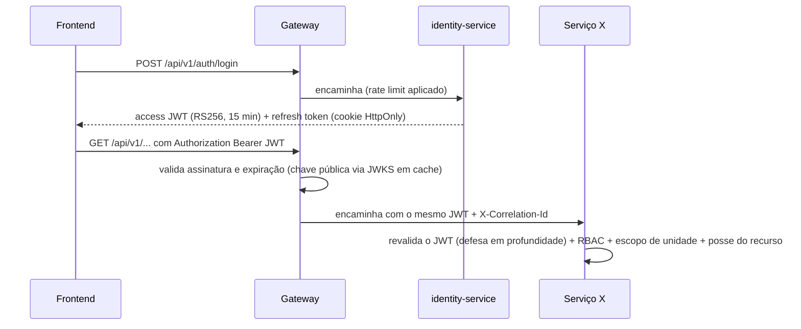

# 06 — Arquitetura: microsserviços + API REST

## 7.1 Análise crítica da premissa

O enunciado sugere 11 serviços. **Para uma equipe acadêmica de 4 a 6 pessoas, isso é microsserviço "para cumprir requisito"**: cada serviço exige build, deploy, banco, segurança, testes e observabilidade próprios. O custo cresce de forma linear e o valor não acompanha.

> **Posição técnica honesta:** para o tamanho deste problema, um *monólito modular* seria tecnicamente suficiente. Como microsserviços são **obrigatórios**, a decomposição abaixo usa o **mínimo de serviços que ainda demonstra os conceitos com valor real**: fronteiras por capacidade de negócio, isolamento de dados sensíveis, comunicação síncrona e assíncrona, falhas independentes e deploy independente.

### Critérios usados para decompor

1. **Capacidade de negócio coesa** (bounded context, DDD).
2. **Sensibilidade do dado**: dados de saúde num único serviço com controles reforçados.
3. **Acoplamento transacional**: o que precisa mudar junto, numa única transação, fica junto.
4. **Perfil de execução**: workers assíncronos (notificações) separados de APIs síncronas.
5. **Capacidade da equipe**: no máximo 1 serviço por pessoa como responsável principal.

### O que acontece com cada serviço sugerido

| Serviço sugerido | Destino | Motivo |
|---|---|---|
| API Gateway | **Mantido** (componente pronto, sem regra de negócio) | Ponto único de entrada, TLS, rate limit, roteamento, CORS. |
| Auth Service | **Fundido** em `identity-service` | Autenticação e contas mudam juntas; separar criaria chamadas síncronas a cada login. |
| User/Donor Service | **Fundido** em `identity-service` | Dados cadastrais e consentimentos pertencem à identidade. |
| Appointment Service | **Mantido** como `scheduling-service` | Unidades, grade, slots, bloqueios e agendamentos formam um contexto coeso com transações próprias. |
| Screening Service | **Fundido** em `clinical-service` | Pré-triagem e triagem são dados de saúde. |
| Donation Service | **Fundido** em `clinical-service` | A doação depende da triagem na mesma transação. Separar exigiria saga para algo trivial. |
| Document Service | **Módulo** de `clinical-service`, extraível | O comprovante é uma renderização do atendimento. Interface interna isolada, que pode virar serviço na V2. |
| Blood Inventory Service | **Mantido** como `inventory-service` | Domínio distinto (estoque), outro perfil de usuário, sem dados pessoais. |
| Gamification Service | **Mantido** como `engagement-service` (gamificação + horas complementares) | Consumidor puro de eventos: ótimo exemplo didático de desacoplamento. |
| Notification Service | **Mantido** (worker) | Integração externa trocável, retry e DLQ; não pode derrubar o fluxo principal. |
| Admin/Reporting Service | **Removido do MVP**; V2 como read-model | No MVP, o dashboard compõe endpoints de estatística de cada serviço. Na V2, um `reporting-service` consome eventos (CQRS). |

**Resultado: gateway + 6 serviços** (4 APIs de domínio, 1 consumidor de domínio, 1 worker de integração).

---

## 7.2 Visão de contexto (C4 nível 1)



## 7.3 Visão de contêineres (C4 nível 2)



> Os serviços validam o JWT localmente com a chave pública (JWKS) do identity-service, mantida em cache, e por isso não há chamada ao identity a cada requisição.

---

## 7.4 Responsabilidades

| Serviço | Responsabilidade | Não faz |
|---|---|---|
| **gateway** | Terminação TLS, roteamento por prefixo, validação de JWT (primeira barreira), rate limiting, CORS, cabeçalhos de segurança, geração e propagação de `X-Correlation-Id`. | Regra de negócio ou agregação de dados. |
| **identity-service** | Cadastro de doadores e profissionais, login, refresh, logout, recuperação de senha, papéis e permissões, vínculo profissional–unidade, consentimentos (LGPD), publicação de JWKS, orquestração de pedidos de exclusão e anonimização. | Guardar dados de saúde, inclusive o tipo sanguíneo. |
| **scheduling-service** | Unidades, grade semanal, slots materializados, bloqueios, campanhas, agendamentos (estados), check-in, faltas, lembretes (job), projeção local de elegibilidade (vinda de eventos), estatísticas de agenda. | Decidir elegibilidade clínica. |
| **clinical-service** | Questionários e conjuntos de regras versionados, motor de regras, pré-triagens, sessões de triagem [SIMULAÇÃO], registros de doação [SIMULAÇÃO], cálculo da data informativa de nova elegibilidade, **módulo de documentos** (PDF, verificação), tipo sanguíneo autodeclarado (com consentimento), estatísticas de doação. | Mexer no estoque ou enviar mensagens diretamente. |
| **inventory-service** | Níveis de estoque por unidade, tipo ABO/Rh e hemocomponente; parâmetros mínimo e ideal; movimentações (ledger); status; snapshots diários; nível público agregado; alertas. **[SIMULAÇÃO]** | Lidar com dados pessoais. |
| **engagement-service** | Ledger de pontos, níveis, catálogo de conquistas, concessão a partir de eventos, ranking opt-in, metas coletivas (V2), pedidos de horas complementares e aprovação institucional (V2). | Ler dados clínicos. Recebe apenas fatos mínimos nos eventos. |
| **notification-service** | Consumir eventos, aplicar preferências, renderizar templates, enviar por canais plugáveis, retry e DLQ, histórico de envios, notificações in-app (V2). | Decidir *quando* um evento de negócio ocorre. |

---

## 7.5 Comunicação entre serviços

### Síncrona (REST)

- **Externa:** frontend → gateway → serviço, sempre REST/JSON, versionada em `/api/v1`.
- **Interna:** reduzida ao mínimo. **No MVP há uma única chamada síncrona entre serviços:**
  - `clinical-service → scheduling-service` (`GET /internal/appointments/{id}`) ao abrir uma triagem, para confirmar o status CHECKED_IN e a unidade.
  - Proteções: timeout de 2 s, 1 retry só para GET, circuit breaker (Resilience4j) e fallback de "atendimento pendente de vínculo".
  - Rotas `/internal/**` **não passam pelo gateway**. Ficam na rede interna do Docker e exigem um token de serviço (client credentials emitido pelo identity-service, ou mTLS na V2).

### Assíncrona (eventos)

- **Broker:** RabbitMQ, com o exchange `pulso.events` do tipo *topic*. Escolhido por ser simples de operar, ter painel visual (bom para a demonstração) e oferecer DLQ nativa. Kafka seria exagero para o volume e para a equipe.
- **Padrão Transactional Outbox:** o serviço grava o evento na tabela `outbox_events` **na mesma transação** da mudança de estado; um relay (job a cada 1 s) publica e marca como enviado. Isso evita o problema de "gravei no banco mas não publiquei", sem transação distribuída.
- **Consumidores idempotentes:** cada consumidor grava `event_id` em `processed_events` (PK). Eventos repetidos são ignorados. A entrega é *at-least-once*.

### Envelope padrão (inspirado no CloudEvents)

```json
{
  "id": "0192a3c4-...-uuidv7",
  "type": "clinical.donation.completed.v1",
  "source": "clinical-service",
  "time": "2026-11-14T10:32:00Z",
  "correlationId": "c0ffee-...",
  "subject": "donor:5b1e...",
  "data": {
    "donationId": "…",
    "donorId": "…",
    "unitId": "…",
    "occurredAt": "2026-11-14T10:30:00Z"
  }
}
```

### Catálogo de eventos (MVP)

| Evento | Produtor | Consumidores | Dados (mínimos) |
|---|---|---|---|
| `identity.user.registered.v1` | identity | notification | userId, nome para saudação, e-mail* |
| `identity.user.erasure_requested.v1` | identity | todos | userId (cada serviço anonimiza o que é seu) |
| `scheduling.appointment.booked.v1` | scheduling | notification | appointmentId, donorId, unitId, startsAt, código |
| `scheduling.appointment.cancelled.v1` | scheduling | notification | appointmentId, donorId, motivo categorizado |
| `scheduling.appointment.rescheduled.v1` | scheduling | notification | oldId, newId, startsAt |
| `scheduling.appointment.reminder_due.v1` | scheduling (job) | notification | appointmentId, donorId, startsAt |
| `scheduling.appointment.checked_in.v1` | scheduling | clinical (opcional) | appointmentId, unitId, donorId |
| `clinical.attendance.finished.v1` | clinical | scheduling, engagement | attendanceId, appointmentId?, donorId, donationCompleted (bool), nextEligibleDate?, remindersBlocked (bool) |
| `clinical.donation.completed.v1` | clinical | engagement, notification | donationId, donorId, unitId, occurredAt |
| `clinical.donor.eligible_again.v1` | clinical (job) | notification | donorId |
| `clinical.document.issued.v1` | clinical | notification | documentId, donorId |
| `inventory.stock.level_changed.v1` | inventory | notification | unitId, bloodType, component, fromStatus, toStatus |
| `engagement.achievement.unlocked.v1` | engagement | notification | donorId, achievementCode |

\* Alternativa mais restritiva: o notification-service resolve o e-mail chamando o identity, para que nenhum evento carregue contato. No MVP aceitamos o e-mail no evento de cadastro, porque o notification precisa dele e a fila é interna. **Dados clínicos e motivos de inaptidão nunca trafegam em eventos** (RNF10).

> **Por que `nextEligibleDate` e `remindersBlocked` podem trafegar?** O scheduling precisa deles para alertar (RN04) e o notification para não convidar (RN17). São fatos derivados que não revelam o motivo clínico. Mesmo assim, é um ponto a revisar com o encarregado de dados [VALIDAR-JURÍDICO].

---

## 7.6 Autenticação e autorização



- **Claims do JWT:** `sub` (userId), `roles` (ex.: `["DOADOR"]`), `unit_ids` (para profissionais), `iat`, `exp`, `jti`, `iss`, `aud`. **Nunca** incluir dados pessoais ou de saúde.
- **Validação em dois pontos:** o gateway barra o que é obviamente inválido e cada serviço valida de novo, para não confiar cegamente na rede interna.
- **Autorização em três camadas:**
  1. **RBAC:** o papel permite a operação (ex.: `screening:decide` só para PROFISSIONAL_TRIAGEM).
  2. **Escopo:** o recurso pertence a uma unidade presente em `unit_ids`.
  3. **Posse:** o doador só acessa os próprios recursos (`resource.donorId == sub`), o que bloqueia IDOR/BOLA.
- **Produção:** substituir a emissão própria por um IdP maduro (Keycloak, ou Login gov.br para cidadãos). **Os serviços não mudam**, porque só validam JWT via JWKS.

### Papéis e permissões (MVP)

| Permissão | DOADOR | COLABORADOR | PROF_TRIAGEM | ADMIN_UNIDADE | GESTOR_ESTOQUE | ADMIN_SISTEMA |
|---|:-:|:-:|:-:|:-:|:-:|:-:|
| appointment:book/cancel (próprio) | ✔ | | | | | |
| agenda:read (unidade) | | ✔ | ✔ | ✔ | | |
| appointment:check-in / no-show | | ✔ | ✔ | ✔ | | |
| prescreening:read (com consentimento) | | | ✔ | | | |
| screening:decide, donation:record | | | ✔ | | | |
| schedule:manage, unit:manage | | | | ✔ | | ✔ |
| staff:manage (unidade) | | | | ✔ | | ✔ |
| inventory:read | | | | ✔ | ✔ | ✔ |
| inventory:move, thresholds:manage | | | | | ✔ | |
| dashboard:read | | | | ✔ | ✔ | ✔ |
| rules:draft | | | | | | ✔ |
| rules:approve | | | ✔* | | | |
| audit:read | | | | | | ✔ |

\* `rules:approve` deve ser atribuído **somente** ao profissional designado como responsável técnico [VALIDAR-SAÚDE]. O ADMIN_SISTEMA **não** acessa dados clínicos (segregação de funções).

---

## 7.7 Banco de dados por serviço: estratégia simplificada e justificada

**Decisão:** **uma instância PostgreSQL, um schema por serviço e um usuário de banco por serviço**, cada um com permissão só no próprio schema.

| Opção | Prós | Contras | Decisão |
|---|---|---|---|
| 1 banco compartilhado com tabelas misturadas | Simples | Acoplamento total; deixa de ser microsserviço | ❌ |
| **1 instância, schema por serviço, usuário por serviço** | Isolamento lógico garantido pelo banco (GRANT), um só contêiner, backups simples, migração futura trivial | Ponto único de falha da instância; recursos compartilhados | ✅ **MVP** |
| 1 instância PostgreSQL por serviço | Isolamento físico | 6 contêineres de banco a mais e muita RAM no notebook dos alunos | V2/produção, se necessário |

**Regras obrigatórias para não "trapacear" no isolamento:**
- Nenhum `JOIN` entre schemas. Referências entre serviços são **apenas UUIDs** (sem FK física).
- Cada serviço tem suas migrações Flyway e seu usuário (`identity_app`, `scheduling_app`…).
- Um serviço que precisa de dado de outro usa evento (projeção local) ou API.
- O schema `clinical` recebe cifragem de colunas na aplicação e auditoria de leitura.

---

## 7.8 Filas, retry e DLQ

| Fila | Ligação (routing key) | Consumidor | DLQ |
|---|---|---|---|
| `scheduling.q` | `clinical.attendance.*` | scheduling-service | `scheduling.dlq` |
| `engagement.q` | `clinical.attendance.*`, `clinical.donation.*` | engagement-service | `engagement.dlq` |
| `notification.q` | `#` (filtra por tipo no handler) | notification-service | `notification.dlq` |
| `clinical.q` | `scheduling.appointment.checked_in.*`, `identity.user.erasure_requested.*` | clinical-service | `clinical.dlq` |

- **Retry:** 3 tentativas com backoff exponencial (1 s, 5 s, 25 s) por meio de fila de espera com TTL. Depois disso, a mensagem vai para a DLQ.
- **DLQ:** monitorada no painel do RabbitMQ; reprocessamento manual por endpoint administrativo.
- **Mensagem "venenosa"** (erro de validação): vai direto para a DLQ, sem retry.

---

## 7.9 Logs, auditoria e observabilidade

| Aspecto | MVP | V2 |
|---|---|---|
| Logs | JSON estruturado (Logback + logstash-encoder) com `correlationId`, `service`, `userId` pseudonimizado; **sem PII nem dados de saúde** | Loki ou ELK centralizado |
| Correlação | Gateway gera `X-Correlation-Id`, propagado em HTTP e nos eventos | OpenTelemetry + Jaeger (traces distribuídos) |
| Métricas | Actuator `/actuator/health`, `/actuator/metrics` | Prometheus + Grafana (taxa de erro, latência p95, fila) |
| Auditoria | Tabela `audit_logs` somente de inserção em cada schema: ator, ação, recurso, resultado, IP, quando | Envio a armazenamento imutável |
| Health checks | `healthcheck` no docker-compose; o gateway só roteia para serviços saudáveis | Readiness e liveness no Kubernetes |

---

## 7.10 Tratamento de falhas

| Cenário | Comportamento esperado |
|---|---|
| notification-service fora do ar | Agendamentos e doações seguem normalmente; eventos se acumulam na fila e são enviados quando ele volta. |
| engagement-service fora do ar | Pontos são concedidos depois (fila). O doador vê "atualizando pontuação". |
| RabbitMQ fora do ar | Eventos ficam na outbox; o relay tenta novamente. Nenhuma transação de negócio falha. |
| scheduling-service fora do ar ao abrir uma triagem | Circuit breaker abre; o profissional registra o atendimento "pendente de vínculo"; reconciliação posterior. |
| identity-service fora do ar | Tokens válidos continuam funcionando (JWKS em cache). Login e cadastro indisponíveis, com mensagem clara. |
| PostgreSQL fora do ar | Indisponibilidade geral (ponto único aceito no MVP); `restart: unless-stopped`, backup diário. |
| Corrida por vaga | UPDATE condicional + índice único parcial impedem a sobrealocação; o perdedor recebe 409. |
| Requisição de agendamento repetida (rede instável) | `Idempotency-Key` devolve a mesma resposta. |
| Evento duplicado | `processed_events` garante idempotência. |
| Erro de validação | 400/422 no formato Problem Details (RFC 9457). |

---

## 26. Matriz de microsserviços e banco

| Microsserviço | Responsabilidade | Banco (schema) | Endpoints principais | Dependências |
|---|---|---|---|---|
| **gateway** | Entrada única, segurança de borda | — (Redis opcional para rate limit distribuído na V2) | roteia `/api/v1/**` | identity (JWKS) |
| **identity-service** | Contas, autenticação, papéis, consentimentos | `identity`: users, donor_profiles, professionals, professional_units, roles, permissions, role_permissions, user_roles, consents, refresh_tokens, password_reset_tokens, audit_logs, outbox_events | `/auth/*`, `/donors`, `/donors/me`, `/donors/me/consents`, `/professionals`, `/.well-known/jwks.json` | RabbitMQ (publica) |
| **scheduling-service** | Agenda e atendimento logístico | `scheduling`: health_units, schedule_rules, slots, schedule_blocks, campaigns, appointments, donor_eligibility_projection, scheduling_settings, audit_logs, outbox_events, processed_events | `/units`, `/units/{id}/schedule-rules`, `/units/{id}/blocks`, `/appointments/available`, `/appointments`, `/appointments/me`, `/appointments/{id}/cancel`, `/appointments/{id}/reschedule`, `/appointments/{id}/check-in`, `/units/{id}/agenda`, `/appointments/statistics` | identity (JWKS), RabbitMQ (pub/sub) |
| **clinical-service** | Pré-triagem, regras, triagem, doação, documentos | `clinical`: questionnaires, screening_questions, rule_sets, screening_rules, pre_screenings, screening_sessions, donation_records, donor_health_profile, documents, document_share_links, audit_logs, outbox_events, processed_events | `/screenings/pre-check/*`, `/screenings`, `/donations`, `/donations/me`, `/donations/statistics`, `/documents/*`, `/rule-sets/*` | scheduling (REST interno), identity (JWKS), RabbitMQ, armazenamento de arquivos |
| **inventory-service** | Estoque simulado | `inventory`: inventory_levels, inventory_movements, inventory_daily_snapshots, audit_logs, outbox_events | `/blood-inventory`, `/blood-inventory/public`, `/blood-inventory/movements`, `/blood-inventory/{id}/thresholds`, `/blood-inventory/history` | identity (JWKS), RabbitMQ (publica) |
| **engagement-service** | Gamificação e horas | `engagement`: points_ledger, achievements, donor_achievements, donor_engagement_summary, partner_institutions (V2), complementary_hours_requests (V2), processed_events, outbox_events | `/engagement/me`, `/achievements`, `/engagement/ranking` (opt-in), `/complementary-hours` (V2) | RabbitMQ (pub/sub) |
| **notification-service** | Envio multicanal | `notification`: notification_templates, notification_preferences, notifications, processed_events | `/notifications/preferences/me`, `/notifications/me` (V2) | RabbitMQ (consome), provedor de e-mail |

---

## 7.11 Plano B por tamanho de equipe

| Equipe | Configuração recomendada |
|---|---|
| 6 ou mais pessoas | Os 6 serviços acima. |
| 4 a 5 pessoas | Juntar `engagement` e `notification` num `engagement-notification-service` (os dois são consumidores de eventos). Total: 5. |
| 3 pessoas | `identity`, `scheduling`, `clinical` (com documentos e gamificação como módulos) e `inventory`. Notificação como módulo do scheduling com interface de porta. Total: 4. Ainda demonstra gateway, eventos e isolamento. |

> Em qualquer cenário, **não abrir mão de**: gateway, JWT validado nos serviços, schema por serviço, ao menos um fluxo assíncrono com outbox e idempotência, e OpenAPI por serviço. É isso que torna a arquitetura *defensável*.
