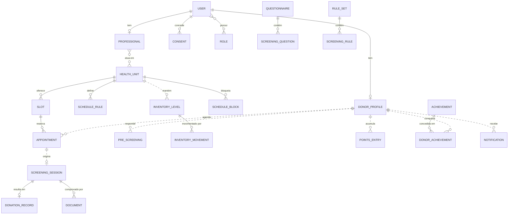
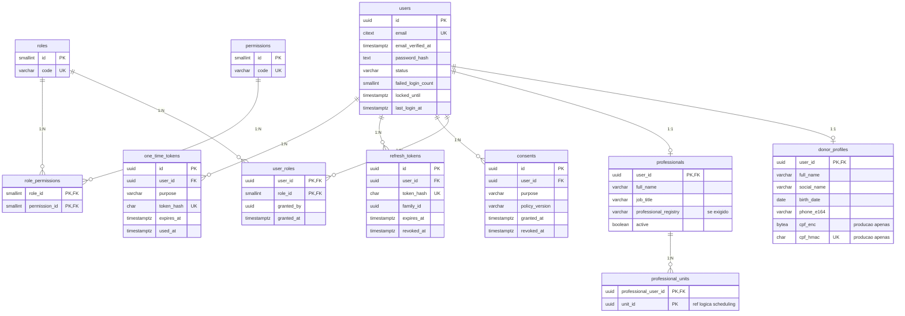
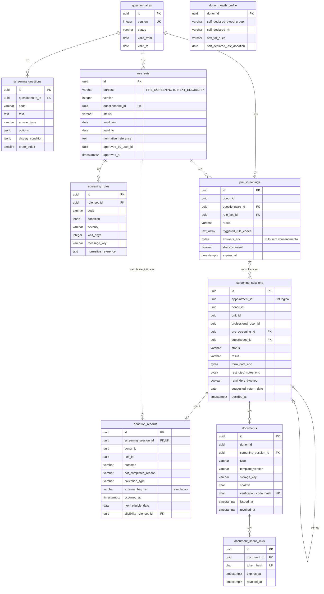
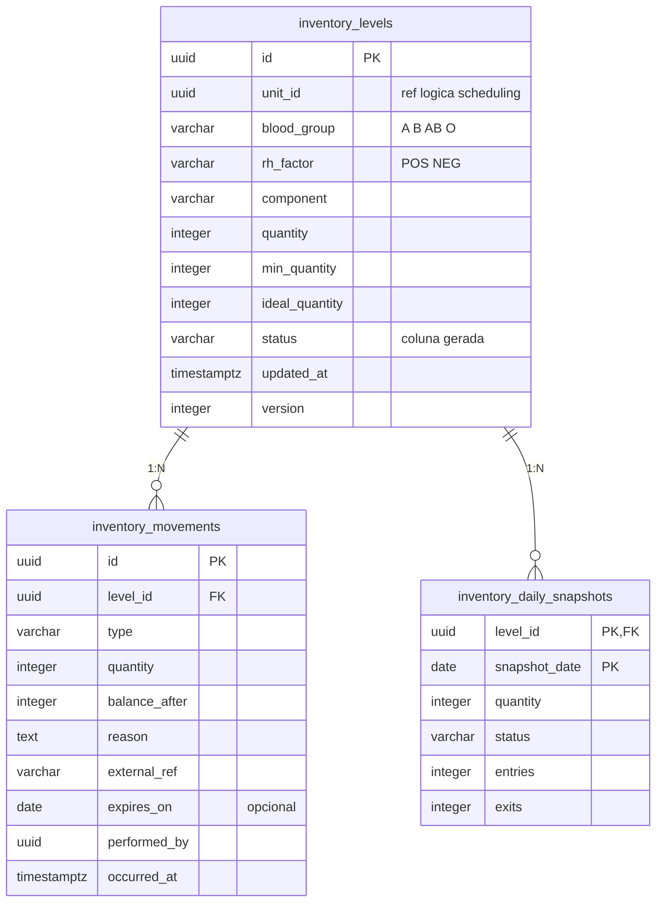
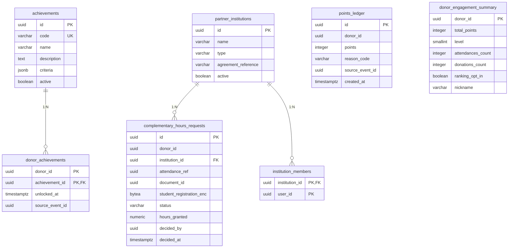

# 07 — Banco de dados

## 8.1 PostgreSQL, MongoDB ou híbrido?

| Critério | PostgreSQL | MongoDB | Híbrido |
|---|---|---|---|
| Integridade transacional (vagas, estoque, ledger de pontos) | ✅ ACID, constraints, `CHECK`, índices únicos parciais | ⚠️ Transações multi-documento existem, mas constraints declarativas são limitadas | ✅ só na parte relacional |
| Dados com estrutura variável (questionários, condições de regra) | ✅ `JSONB` indexável | ✅ natural | — |
| Relatórios e agregações (dashboard) | ✅ SQL, window functions | ⚠️ aggregation pipeline (curva de aprendizado) | ⚠️ dados em dois lugares |
| Segurança (GRANT por schema, RLS, pgcrypto) | ✅ | ⚠️ diferente e menos ensinado | ❌ duas superfícies de ataque |
| Custo operacional para a equipe | 1 tecnologia | 1 tecnologia | **2 tecnologias, backup, migrações e drivers em dobro** |
| Ensino e familiaridade acadêmica | Alta | Média | — |

**Decisão: somente PostgreSQL** (versão 16 ou superior).

- **MongoDB não se justifica:** a única parte "flexível" (questionários e regras) cabe em `JSONB`, e todo o resto é fortemente relacional e transacional.
- **Híbrido só se paga** com um caso de uso que o PostgreSQL não atenda, e esse caso não existe neste escopo.
- **Redis** fica **opcional** (V2) para rate limit distribuído no gateway e cache do nível público de estoque. **Não** é usado para "travar vaga": o banco faz isso melhor e de forma transacional (ver 8.6).

---

## 8.2 Revisão das entidades sugeridas

| Entidade sugerida | Decisão | Justificativa |
|---|---|---|
| users | ✅ Mantida (identity) | Credenciais e status da conta. |
| donors | ✅ Renomeada `donor_profiles` (identity) | Relação 1:1 com users; separa credencial de dado cadastral. |
| professionals | ✅ Mantida + `professional_units` (N:N) | Um profissional pode atuar em mais de uma unidade. |
| roles, permissions | ✅ Mantidas + `role_permissions`, `user_roles` | O N:N exige tabelas associativas. A carga é por migração; não há edição pela interface no MVP. |
| screening_questions | ✅ Mantida + **`questionnaires`** (versão) | Sem versionar o questionário, não dá para auditar qual pergunta foi respondida. |
| screening_answers | 🔁 **Substituída** por coluna cifrada em `pre_screenings` | Uma linha por resposta facilitaria consultas analíticas sobre a saúde de pessoas identificadas, o que **não queremos**. O bloco cifrado com prazo de expiração é mais simples e mais privado. |
| — | ➕ **`rule_sets`, `screening_rules`** | As regras ficam **separadas** das perguntas, versionadas e com aprovação registrada (RN08). |
| — | ➕ **`screening_sessions`** | A triagem presencial não estava na lista. |
| appointments | ✅ Mantida (scheduling) | — |
| schedules | 🔁 Dividida em `schedule_rules` (grade), **`slots`** (vagas concretas), `schedule_blocks`, `campaigns` | Materializar slots torna a checagem de capacidade atômica e simples. |
| health_units | ✅ Mantida (scheduling) | — |
| donation_records | ✅ Mantida (clinical) | — |
| blood_inventory | 🔁 Renomeada `inventory_levels` | Inclui o hemocomponente e o status calculado. |
| blood_inventory_movements | ✅ Renomeada `inventory_movements` | Ledger imutável. |
| — | ➕ `inventory_daily_snapshots` | Histórico e tendência sem reprocessar todo o ledger. |
| gamification_points | 🔁 Renomeada `points_ledger` | Ledger de lançamentos, com idempotência por evento. |
| achievements, donor_achievements | ✅ Mantidas | — |
| complementary_hours | 🔁 `complementary_hours_requests` + `partner_institutions` (V2) | Precisa de fluxo de aprovação institucional. |
| notifications | ✅ Mantida + `notification_templates`, `notification_preferences` | — |
| documents | ✅ Mantida + `document_share_links` | Verificação e compartilhamento seguros. |
| audit_logs | ✅ **Uma por schema** | Cada serviço audita o que é seu. |
| — | ➕ `consents` | Exigência da LGPD (finalidade, versão, revogação). |
| — | ➕ `refresh_tokens`, `one_time_tokens` | Sessão segura e recuperação de senha. |
| — | ➕ `outbox_events`, `processed_events` | Confiabilidade dos eventos. |
| — | ➕ `donor_eligibility_projection` (scheduling) | Cópia local mínima para agendar sem chamar o clinical. |
| — | ➕ `donor_health_profile` (clinical) | Tipo sanguíneo autodeclarado, última doação externa, dado de sexo para regras: **dados sensíveis, isolados**. |

---

## 8.3 Modelo conceitual

Linhas contínuas indicam relacionamento **dentro** de um serviço (FK física). Linhas tracejadas indicam referência **lógica entre serviços**, apenas por UUID.



---

## 8.4 Modelo lógico por schema

> Convenções: PK `uuid` (UUIDv7 gerado na aplicação, ordenável por tempo); `created_at` e `updated_at` (`timestamptz`) em todas as tabelas de negócio; enums como `varchar` + `CHECK` (mais fácil de migrar que `ENUM` nativo); nomes em inglês no banco, para ficar coerente com o código; **(V2)** = fora do MVP.

### Schema `identity`



| Tabela | Constraints e índices relevantes |
|---|---|
| users | `UNIQUE(email)` com `citext` (sem diferenciar maiúsculas); `CHECK status IN ('PENDING_VERIFICATION','ACTIVE','SUSPENDED','ANONYMIZED')` |
| donor_profiles | idade mínima (RN18) validada **na aplicação**: um `CHECK` com `current_date` é má prática, porque o PostgreSQL trata constraints como imutáveis; `social_name` opcional, seguindo a lógica do Decreto nº 8.727/2016 sobre nome social [VALIDAR-JURÍDICO]; `cpf_*` **nulos no protótipo** |
| consents | `CHECK purpose IN ('TERMS_PRIVACY','MARKETING_INSTITUCIONAL','SHARE_PRESCREENING','BLOOD_TYPE_SELF_DECLARED','RANKING_OPT_IN')`; índice único parcial `(user_id, purpose) WHERE revoked_at IS NULL` |
| refresh_tokens | índice `(family_id)` para revogar a família inteira ao detectar reuso |

### Schema `scheduling`

```mermaid
erDiagram
    health_units ||--o{ schedule_rules : "1:N"
    health_units ||--o{ slots : "1:N"
    health_units ||--o{ schedule_blocks : "1:N"
    health_units ||--o{ campaigns : "1:N"
    health_units ||--|| scheduling_settings : "1:1"
    campaigns ||--o{ slots : "0:N"
    slots ||--o{ appointments : "1:N"
    health_units ||--o{ appointments : "1:N"
    appointments ||--o| appointments : "reagendado de"

    health_units {
        uuid id PK
        varchar name
        varchar slug UK
        varchar city
        char state
        varchar address_line
        numeric latitude
        numeric longitude
        varchar timezone
        boolean active
    }
    schedule_rules {
        uuid id PK
        uuid unit_id FK
        smallint weekday "1-7 ISO"
        time start_time
        time end_time
        smallint slot_minutes
        smallint capacity_per_slot
        smallint daily_capacity
        date valid_from
        date valid_to
    }
    slots {
        uuid id PK
        uuid unit_id FK
        uuid campaign_id FK
        timestamptz starts_at
        timestamptz ends_at
        smallint capacity
        smallint booked_count
        varchar status
    }
    schedule_blocks {
        uuid id PK
        uuid unit_id FK
        timestamptz starts_at
        timestamptz ends_at
        varchar reason
        uuid created_by
    }
    campaigns {
        uuid id PK
        uuid unit_id FK
        varchar name
        varchar code UK
        date starts_on
        date ends_on
        varchar partner_type
    }
    appointments {
        uuid id PK
        varchar code UK
        uuid donor_id "ref logica identity"
        uuid unit_id FK
        uuid slot_id FK
        uuid campaign_id FK
        uuid rescheduled_from_id FK
        varchar kind
        varchar status
        timestamptz starts_at
        varchar idempotency_key
        timestamptz checked_in_at
        timestamptz cancelled_at
        varchar cancel_reason
        integer version
    }
    scheduling_settings {
        uuid unit_id PK, FK
        integer cancel_window_minutes
        smallint max_active_per_donor
        integer no_show_tolerance_minutes
        integer reminder_hours_before
        integer booking_max_days_ahead
    }
    donor_eligibility_projection {
        uuid donor_id PK
        date next_eligible_date
        boolean reminders_blocked
        uuid source_event_id
    }
```



| Tabela | Constraints e índices relevantes |
|---|---|
| schedule_rules | `CHECK (end_time > start_time)`, `CHECK (slot_minutes BETWEEN 10 AND 120)`, `CHECK (capacity_per_slot > 0)` |
| slots | `UNIQUE(unit_id, starts_at)`; `CHECK (booked_count BETWEEN 0 AND capacity)`; índice parcial `(unit_id, starts_at) WHERE status = 'OPEN'` |
| schedule_blocks | `CHECK (ends_at > starts_at)`; índice `(unit_id, starts_at, ends_at)` |
| appointments | `CHECK status IN ('BOOKED','CONFIRMED','CHECKED_IN','COMPLETED','CANCELLED','NO_SHOW')`; `CHECK kind IN ('SCHEDULED','WALK_IN')`; `CHECK (kind = 'WALK_IN' OR slot_id IS NOT NULL)`; **índice único parcial** `(donor_id) WHERE status IN ('BOOKED','CONFIRMED','CHECKED_IN')` (RN03); `UNIQUE(donor_id, idempotency_key)`; índices `(unit_id, starts_at)` para a agenda do dia e `(donor_id, starts_at DESC)` para "meus agendamentos" |

### Schema `clinical` (dados sensíveis)



| Tabela | Constraints e índices relevantes |
|---|---|
| questionnaires, rule_sets | `CHECK status IN ('DRAFT','PUBLISHED','RETIRED')`; **`CHECK (status <> 'PUBLISHED' OR approved_by_user_id IS NOT NULL)`**, ou seja, nada é publicado sem aprovação (RN08); índice único parcial: só 1 versão PUBLISHED por `purpose` com vigência aberta |
| screening_rules | `UNIQUE(rule_set_id, code)`; `CHECK severity IN ('INFORMATIVA','CONVERSAR_COM_UNIDADE','AGUARDAR')` |
| pre_screenings | `CHECK result IN ('PODE_PROSSEGUIR','CONVERSAR_COM_UNIDADE','AGUARDAR')`; `CHECK (share_consent OR answers_enc IS NULL)`; job diário zera `answers_enc` depois de `expires_at` |
| screening_sessions | `CHECK result IN ('APTO','NAO_APTO')`; `CHECK status IN ('OPEN','LINK_PENDING','DECIDED','CANCELLED')`; `CHECK (status <> 'DECIDED' OR result IS NOT NULL)`; o registro decidido é imutável (correção = nova linha com `supersedes_id`) |
| donation_records | `CHECK ((outcome = 'NOT_COMPLETED') = (not_completed_reason IS NOT NULL))`; `CHECK not_completed_reason IN ('INTERRUPTED','DONOR_WITHDREW','OTHER_NON_CLINICAL')`; índice `(donor_id, occurred_at DESC)` |
| donor_health_profile | `CHECK sex_for_rules IN ('F','M','NAO_INFORMADO')`; **coleta só com finalidade explicada e somente se a regra vigente exigir** [VALIDAR-SAÚDE] |
| documents | `UNIQUE(screening_session_id, type)`; `CHECK type IN ('COMPROVANTE_COMPARECIMENTO','COMPROVANTE_DOACAO')` |

### Schema `inventory` — [SIMULAÇÃO]



| Tabela | Constraints e índices relevantes |
|---|---|
| inventory_levels | `UNIQUE(unit_id, blood_group, rh_factor, component)`; `CHECK (quantity >= 0)`; `CHECK (ideal_quantity >= min_quantity AND min_quantity >= 0)`; `status` como **coluna gerada** (RN11) |
| inventory_movements | `CHECK type IN ('ENTRADA','SAIDA','DESCARTE','AJUSTE_POSITIVO','AJUSTE_NEGATIVO')`; `CHECK (quantity > 0)`; `CHECK (type NOT LIKE 'AJUSTE%' OR length(reason) >= 10)`; o usuário da aplicação **não tem** `UPDATE` nem `DELETE` (ledger imutável); índice `(level_id, occurred_at DESC)` |

> **Hemocomponente:** o estoque real é controlado por hemocomponente (concentrado de hemácias, plasma, plaquetas…), cada um com regras próprias de validade [VALIDAR-SAÚDE]. O padrão do protótipo é `CONCENTRADO_HEMACIAS`, e a coluna existe para não engessar o modelo. Validade por lote (`inventory_lots`) fica para a V2.

### Schema `engagement`



| Tabela | Constraints e índices relevantes |
|---|---|
| points_ledger | **`UNIQUE(source_event_id, reason_code)`** (idempotência); `CHECK reason_code IN ('ATTENDANCE','DONATION_BONUS','REVERSAL')`; índice `(donor_id, created_at DESC)` |
| donor_achievements | PK composta impede conceder duas vezes |
| complementary_hours_requests (V2) | `UNIQUE(attendance_ref, institution_id)`; `CHECK status IN ('PENDENTE','APROVADA','REJEITADA')`; `CHECK (status <> 'APROVADA' OR hours_granted > 0)`; as horas são definidas **pela instituição** (RN15) |

### Schema `notification`

| Tabela | Colunas principais | Constraints |
|---|---|---|
| notification_templates | id, code, channel, locale, version, subject, body, active | `UNIQUE(code, channel, locale, version)` |
| notification_preferences | user_id (PK), email_enabled, push_enabled, sms_enabled, marketing_opt_in, quiet_start, quiet_end | — |
| notifications | id, user_id, event_id, template_code, template_version, channel, status, attempts, last_error, recipient_masked, sent_at | `CHECK status IN ('PENDING','SENT','FAILED','SKIPPED')`; `UNIQUE(event_id, channel)`; **o corpo da mensagem não é guardado** (minimização) |

### Tabelas técnicas presentes em cada schema

| Tabela | Colunas | Observação |
|---|---|---|
| `outbox_events` | id (PK), aggregate_type, aggregate_id, event_type, payload `jsonb`, created_at, published_at, attempts | índice parcial `WHERE published_at IS NULL` |
| `processed_events` | event_id (PK), event_type, processed_at | idempotência dos consumidores |
| `audit_logs` | id, occurred_at, actor_user_id, actor_roles, action, resource_type, resource_id, outcome (`SUCCESS`/`DENIED`/`FAILURE`), correlation_id, ip_hash, details `jsonb` | **somente INSERT/SELECT** para o usuário da aplicação; `details` nunca contém dado de saúde; particionamento mensal na V2 |

---

## 8.5 Relacionamentos e cardinalidades (resumo)

| Relação | Cardinalidade | Tipo |
|---|---|---|
| users → donor_profiles | 1 : 0..1 | FK física (identity) |
| users → professionals | 1 : 0..1 | FK física |
| users ↔ roles | N : N | via `user_roles` |
| roles ↔ permissions | N : N | via `role_permissions` |
| professionals ↔ health_units | N : N | `professional_units` + referência lógica |
| health_units → slots | 1 : N | FK física (scheduling) |
| slots → appointments | 1 : N (até `capacity` ativos) | FK física + `CHECK` |
| donor → appointments | 1 : N (no máximo 1 ativo) | lógica + índice único parcial |
| appointments → screening_sessions | 1 : 0..1 (espontâneo: sem agendamento) | lógica (entre serviços) |
| screening_sessions → donation_records | 1 : 0..1 | FK física + `UNIQUE` |
| screening_sessions → documents | 1 : 0..2 (um por tipo) | FK física + `UNIQUE` |
| rule_sets → screening_rules | 1 : N | FK física |
| inventory_levels → inventory_movements | 1 : N | FK física |
| achievements ↔ donors | N : N | `donor_achievements` |
| donor → points_ledger | 1 : N | lógica |

---

## 8.6 Trechos de DDL críticos

```sql
-- Vaga reservada de forma atômica (sem Redis, sem lock distribuído)
UPDATE scheduling.slots
   SET booked_count = booked_count + 1
 WHERE id = :slotId
   AND status = 'OPEN'
   AND booked_count < capacity;      -- 0 linhas afetadas => 409 SLOT_FULL

-- RN03: no máximo um agendamento ativo por doador (garantido pelo banco)
CREATE UNIQUE INDEX ux_appointments_one_active_per_donor
    ON scheduling.appointments (donor_id)
 WHERE status IN ('BOOKED', 'CONFIRMED', 'CHECKED_IN');

-- RN11: status do estoque calculado pelo próprio banco
CREATE TABLE inventory.inventory_levels (
    id              uuid PRIMARY KEY,
    unit_id         uuid        NOT NULL,
    blood_group     varchar(2)  NOT NULL CHECK (blood_group IN ('A','B','AB','O')),
    rh_factor       varchar(3)  NOT NULL CHECK (rh_factor IN ('POS','NEG')),
    component       varchar(30) NOT NULL DEFAULT 'CONCENTRADO_HEMACIAS',
    quantity        integer     NOT NULL DEFAULT 0 CHECK (quantity >= 0),
    min_quantity    integer     NOT NULL CHECK (min_quantity >= 0),
    ideal_quantity  integer     NOT NULL,
    status          varchar(10) GENERATED ALWAYS AS (
                        CASE WHEN quantity < min_quantity   THEN 'CRITICO'
                             WHEN quantity < ideal_quantity THEN 'ATENCAO'
                             ELSE 'ADEQUADO' END) STORED,
    updated_at      timestamptz NOT NULL DEFAULT now(),
    version         integer     NOT NULL DEFAULT 0,
    CONSTRAINT ck_ideal_ge_min CHECK (ideal_quantity >= min_quantity),
    CONSTRAINT ux_level UNIQUE (unit_id, blood_group, rh_factor, component)
);

-- Ledger imutável
REVOKE UPDATE, DELETE ON inventory.inventory_movements FROM inventory_app;

-- Pontos idempotentes por evento
ALTER TABLE engagement.points_ledger
  ADD CONSTRAINT ux_points_event UNIQUE (source_event_id, reason_code);

-- Isolamento por serviço
CREATE ROLE clinical_app LOGIN PASSWORD :'secret';
GRANT USAGE ON SCHEMA clinical TO clinical_app;
REVOKE ALL ON SCHEMA identity, scheduling, inventory, engagement, notification FROM clinical_app;
```

---

## 8.7 Auditoria, retenção e anonimização

| Dado | Retenção proposta | Ao fim do prazo | Etiqueta |
|---|---|---|---|
| Respostas da pré-triagem | 30 dias após o agendamento, ou após a pré-triagem se não houver agendamento | `answers_enc = NULL` (fica só o resultado) | [HIPÓTESE] |
| Sessões de triagem e doações (protótipo) | Enquanto a conta existir | Anonimização na exclusão da conta | [SIMULAÇÃO] |
| Registros clínicos reais (produção) | Definidos pela norma sanitária e pela instituição | — | [VALIDAR-SAÚDE] [VALIDAR-JURÍDICO] |
| Logs de auditoria | 1 ano no protótipo | Expurgo | [HIPÓTESE] |
| Notificações enviadas | 90 dias | Expurgo | [HIPÓTESE] |
| Refresh tokens e tokens de uso único | Até expirar + 7 dias | Expurgo | — |

**Exclusão de conta (LGPD, art. 18, VI):** o identity marca `ANONYMIZED`, apaga e-mail, nome e telefone e publica `identity.user.erasure_requested.v1`; cada serviço substitui as referências pessoais pelo que lhe cabe. Estatísticas agregadas são preservadas sem identificação. Quando houver obrigação legal de guardar algum dado, a guarda prevalece (LGPD, art. 16, I) [VALIDAR-JURÍDICO].
