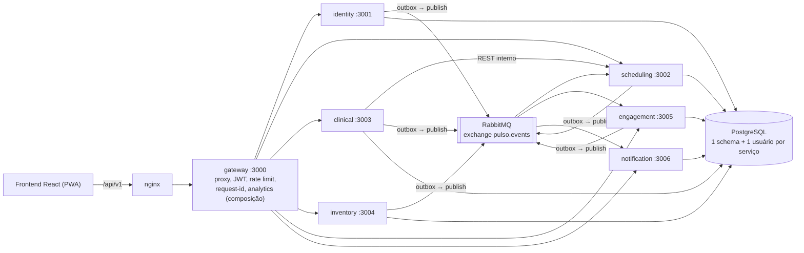
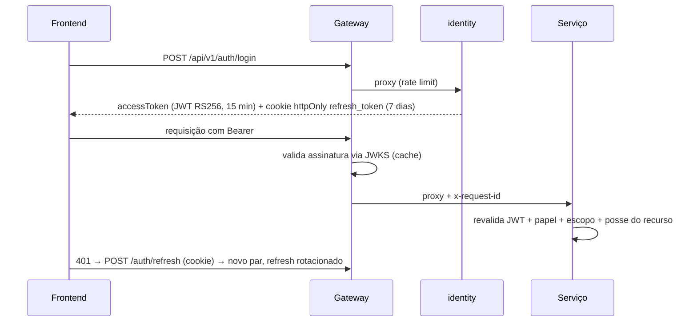

# 16 — Plano de implementação do aplicativo

> Documento vivo do Tech Lead. Ele é a **especificação de referência** para o código: estrutura, contratos, convenções e decisões. Quando o código divergir deste documento, um dos dois precisa ser corrigido.
>
> **Mudanças em relação aos documentos 01–15 (proposta do Checkpoint 1):**
> - Back-end em **Node.js + NestJS + Prisma** (antes: Spring Boot). A arquitetura não muda, como o documento 08 já previa.
> - **4 papéis fixos** (DONOR, COLLABORATOR, NURSE, ADMIN), em vez dos 6 da proposta.
> - Estoque **central único** no MVP (sem estoque por unidade).
> - Pontos por **comparecimento** por padrão, configurável para "por doação".

---

## 1. Visão geral

**Pulso** — *"Doe sangue. Mantenha a vida pulsando."*

Plataforma web responsiva (PWA) que liga doadores, equipe de coleta e gestão:

| Perfil | O que faz no sistema |
|---|---|
| **Doador** (`DONOR`) | Cadastro, pré-triagem informativa, agendamento, histórico, notificações, conquistas, horas complementares, documentos |
| **Colaborador** (`COLLABORATOR`) | Agenda do dia da unidade e check-in |
| **Enfermeiro** (`NURSE`) | Tudo do colaborador + triagem presencial, resultado, registro da doação |
| **Administrador** (`ADMIN`) | Usuários, unidades, horários, campanhas, estoque, gamificação, relatórios, auditoria |

Todo dado do ambiente acadêmico é **fictício**. A triagem presencial e o estoque são **simulação acadêmica** ([03-requisitos](03-requisitos.md), item 6.4).

---

## 2. Arquitetura



### Como os 11 serviços pedidos viram 6 + gateway

| Pedido | Implementação | Por quê |
|---|---|---|
| API Gateway | `gateway` | Entrada única |
| Auth Service + User/Donor Service | `identity` | Conta, credencial e perfil mudam juntos; separar exigiria chamada síncrona a cada login |
| Appointment Service | `scheduling` | Contexto coeso: unidades, grade, vagas, agendamentos, campanhas |
| Screening + Donation + Document Service | `clinical` | **Todos os dados de saúde num só lugar**, mais fácil de proteger; a doação depende da triagem na mesma transação |
| Blood Inventory Service | `inventory` | Domínio próprio, sem dados pessoais |
| Gamification Service | `engagement` | Consumidor de eventos: pontos, níveis, conquistas, ranking, horas |
| Notification Service | `notification` | Integração externa trocável; não pode derrubar o fluxo principal |
| Admin/Analytics Service | **módulo `analytics` do gateway** (padrão *API Composition*) | Cada serviço calcula os números do próprio domínio; o gateway compõe. Um serviço separado só para isso não teria responsabilidade própria no MVP. Vira read-model (CQRS) na V2 |

### Comunicação

| Tipo | Uso | Regras |
|---|---|---|
| **Externa** | Frontend → nginx → gateway → serviço | REST/JSON em `/api/v1`, JWT Bearer |
| **Síncrona interna** | Apenas `clinical → scheduling` (validar agendamento) e `gateway → serviços` (composição do dashboard) | Rotas `/internal/*`, cabeçalho `x-internal-token`, timeout de 3 s; **nunca** expostas pelo gateway |
| **Assíncrona** | Efeitos colaterais: notificar, pontuar, concluir agendamento | RabbitMQ, exchange *topic* `pulso.events`, **outbox transacional** no produtor, **consumidor idempotente** (`processed_events`), DLQ por fila |

---

## 3. Stack

| Camada | Tecnologia | Observação |
|---|---|---|
| Frontend | React + TypeScript + Vite, Tailwind CSS v4, React Router, TanStack Query, React Hook Form + Zod, Recharts, lucide-react | Uma SPA para os 3 perfis, layouts por perfil |
| Back-end | Node.js 22 + NestJS 11 + TypeScript | Um app NestJS por serviço, em monorepo (npm workspaces) |
| Validação | class-validator / class-transformer (DTOs → Swagger automático); Zod para variáveis de ambiente | |
| ORM | Prisma 6 | Um `schema.prisma` por serviço, cliente gerado em `<serviço>/generated/prisma` (fora do `src`, para o mesmo caminho relativo valer em `src` e em `dist`) |
| Banco | PostgreSQL 16 | 1 instância, 1 schema e 1 usuário por serviço |
| Mensageria | RabbitMQ 3.13 + `amqplib`/`amqp-connection-manager` | Consistente com a proposta do CP1 |
| Autenticação | `jose` (JWT RS256 + JWKS), `@node-rs/argon2` (hash Argon2id) | |
| PDF | `pdfkit` + `qrcode` | |
| Logs | `nestjs-pino` (JSON, `requestId`) | |
| Docs da API | `@nestjs/swagger` em cada serviço (`/docs`) + página agregada no gateway | |
| Testes | Jest (unidade e integração), script E2E da jornada via API, Playwright para a jornada na interface | |
| Infra | Docker, Docker Compose, nginx | `docker compose up --build` |

**Redis:** não é necessário no MVP. O rate limit do gateway é um middleware próprio em memória (janela fixa por IP, testado com relógio injetado), suficiente para uma instância. Redis entra na V2 se houver várias réplicas do gateway.

---

## 4. Microsserviços: responsabilidades e endpoints

> Prefixo externo: `/api/v1`. "Público" = sem token. Perfis entre colchetes.

### gateway (:3000)
- Proxy por prefixo de rota, validação de JWT (1ª barreira), rate limit, `x-request-id`, CORS.
- `GET /health`, `GET /health/services` (estado de cada serviço, banco e broker).
- `GET /dashboard/statistics?from&to&unitId&bloodType` [ADMIN] — composição.
- `GET /dashboard/public-stats` [público] — indicadores agregados para a tela inicial.
- `GET /audit-logs` [ADMIN] — composição das auditorias dos serviços.
- `GET /api/docs` (Swagger UI) e `GET /api/docs-json` — documentação OpenAPI **unificada**, montada a partir do `/docs-json` de cada serviço.

### identity (:3001)
`POST /auth/register` · `POST /auth/login` · `POST /auth/refresh` · `POST /auth/logout` · `GET /users/me` · `PATCH /users/me` · `PATCH /users/me/password` · `GET /donors/me` · `GET /donors/:id` [COLLABORATOR, NURSE, ADMIN; auditado] · `GET /consents/me` · `PUT /consents/me` · `GET /admin/users` · `POST /admin/users` · `PATCH /admin/users/:id` [ADMIN] · `GET /.well-known/jwks.json` [público] · `GET /internal/stats`

### scheduling (:3002)
`GET /units` [público] · `GET /units/:id` · `POST /units` · `PATCH /units/:id` · `GET|PUT /units/:id/schedule-rules` · `POST /units/:id/blocks` · `DELETE /units/:id/blocks/:blockId` [ADMIN] · `GET /appointments/availability?unitId&from&to` · `POST /appointments` · `GET /appointments/me` · `GET /appointments/:id` · `PATCH /appointments/:id/cancel` · `PATCH /appointments/:id/reschedule` [DONOR] · `GET /agenda?unitId&date` · `PATCH /appointments/:id/check-in` · `PATCH /appointments/:id/no-show` [COLLABORATOR, NURSE] · `GET /admin/appointments` [ADMIN] · `GET /campaigns` [público] · `POST|PATCH /campaigns` [ADMIN] · `GET /internal/appointments/:id` · `GET /internal/stats`

### clinical (:3003)
`GET /screenings/questions` · `POST /screenings/pre-check` · `GET /screenings/pre-check/me/latest` [DONOR] · `GET /screenings/pre-check/donor/:donorId/latest` [NURSE; exige consentimento; auditado] · `GET /professional-screenings/fields` · `POST /professional-screenings` [NURSE] · `POST /donations` [NURSE] · `GET /donations/history` [DONOR] · `GET /donations/:id` · `GET /admin/donations` [ADMIN] · `POST /documents/donation` · `GET /documents/me` · `GET /documents/:id/file` [DONOR dono] · `GET /documents/verify/:code` [público] · `GET|PATCH /settings` · `GET|PATCH /screening-config/*` [ADMIN] · `GET /internal/stats`

### inventory (:3004)
`GET /blood-inventory` [ADMIN] · `GET /blood-inventory/public` [público: só níveis] · `POST /blood-inventory/movements` · `GET /blood-inventory/movements` · `GET /blood-inventory/history?days` · `PATCH /blood-inventory/:bloodType/thresholds` [ADMIN] · `GET /internal/stats`

### engagement (:3005)
`GET /gamification/profile` · `GET /achievements` · `GET /gamification/ranking` · `PUT /gamification/ranking/opt-in` · `GET /complementary-hours/me` · `PUT /complementary-hours/institution` [DONOR] · `GET /institutions` [público] · `GET|PATCH /admin/complementary-hours` · `GET|PATCH /admin/achievements` · `GET|PATCH /admin/gamification/settings` · `GET|POST|PATCH /admin/institutions` [ADMIN] · `GET /internal/stats`

### notification (:3006)
`GET /notifications` · `GET /notifications/unread-count` · `PATCH /notifications/:id/read` · `PATCH /notifications/read-all` [autenticado]

### Eventos (exchange `pulso.events`)

| Routing key | Produtor | Consumidores | Payload mínimo |
|---|---|---|---|
| `identity.user.registered` | identity | notification | userId, name, role |
| `scheduling.appointment.booked` | scheduling | notification | appointmentId, code, donorId, unitName, startsAt |
| `scheduling.appointment.cancelled` | scheduling | notification | appointmentId, donorId, startsAt, cancelledBy |
| `scheduling.appointment.rescheduled` | scheduling | notification | appointmentId, previousAppointmentId, donorId, unitName, startsAt |
| `scheduling.appointment.reminder_due` | scheduling (job) | notification | appointmentId, donorId, unitName, startsAt |
| `clinical.attendance.completed` | clinical | scheduling, engagement | appointmentId?, donorId, unitId, screeningId, donationCompleted, donationId?, campaignId?, occurredAt |
| `clinical.donation.completed` | clinical | engagement, notification | donationId, code, donorId, unitId, campaignId?, occurredAt |
| `clinical.document.issued` | clinical | notification | documentId, donorId |
| `inventory.stock.level_changed` | inventory | notification | bloodType, previousStatus, status, quantity |
| `engagement.achievement.unlocked` | engagement | notification | donorId, achievementCode, achievementName |
| `engagement.points.awarded` | engagement | notification | donorId, points, reason, totalPoints |

**Nunca** trafegam em eventos: respostas da pré-triagem, campos da triagem, motivos de inaptidão.

---

## 5. Modelo do banco (por schema)

Convenções: PK `uuid`; `createdAt`/`updatedAt` em tabelas de negócio; enums do Prisma; relações apenas **dentro** do schema; entre serviços, só UUID. Constraints que o Prisma não expressa (CHECK, índice único parcial) entram em SQL na migração.

**Tabelas da lista original que não serão criadas** (justificativa: "não crie tabelas sem necessidade"):
- `roles` / `permissions`: 4 papéis fixos viram um **enum** em `users`; o mapa papel → permissões fica em código (`@pulso/common`), versionado e testado.
- `screening_answers`: as respostas ficam num campo **cifrado** em `pre_screenings`. Uma linha por resposta facilitaria consultas sobre a saúde de pessoas identificadas.
- Snapshots de estoque: o histórico é **reconstruído a partir das movimentações**.

| Schema | Tabelas |
|---|---|
| `identity` | `users` (email único, `passwordHash`, `role`, `status`, `name`), `donor_profiles` (1:1; `birthDate`, `phone`, `donorCode` único), `professional_profiles` (1:1; `unitIds uuid[]`, `registryNumber?`), `consents` (finalidade, versão, `grantedAt`, `revokedAt`), `refresh_tokens` (hash, família, rotação), `audit_logs`, `outbox_events` |
| `scheduling` | `health_units`, `schedule_rules` (dia da semana, início, fim, duração do slot, capacidade), `slots` (único por unidade+início, `bookedCount ≤ capacity`), `schedule_blocks`, `campaigns`, `appointments` (código único; **1 ativo por doador** por índice parcial), `audit_logs`, `outbox_events`, `processed_events` |
| `clinical` | `screening_questions` (etapa 1–6, tipo, opções), `screening_rule_sets` (versão, status, referência normativa, aprovação), `screening_rules` (pergunta, operador, valor, desfecho, `validationStatus`), `pre_screenings` (resultado, regras disparadas, respostas cifradas, consentimento de compartilhamento, expiração), `professional_screening_fields` (campos configuráveis), `professional_screenings` (valores cifrados, resultado), `donations` (código único, status, profissional, unidade, campanha, `nextEligibleAt`), `documents` (código de verificação com hash, sha256 do PDF), `clinical_settings` (chave/valor), `audit_logs`, `outbox_events`, `processed_events` |
| `inventory` | `blood_stock` (PK = tipo sanguíneo; quantidade, mínimo, ideal), `blood_stock_movements` (IN/OUT, quantidade > 0, motivo, responsável, saldo após), `audit_logs`, `outbox_events` |
| `engagement` | `points_entries` (único por evento+motivo), `achievements`, `donor_achievements`, `donor_engagement` (totais, nível, opt-in de ranking, apelido, instituição), `partner_institutions`, `complementary_hours` (PENDING/APPROVED/REJECTED), `engagement_settings`, `outbox_events`, `processed_events` |
| `notification` | `notifications` (usuário **ou** papel-alvo, tipo, título, corpo, link, canal, `readAt`), `processed_events` |

---

## 6. Estrutura de pastas

```
/
├─ frontend/                     React + Vite (doador, equipe, admin)
│  └─ src/{app,components,features,layouts,lib,pages,styles}
├─ backend/
│  ├─ gateway/                   NestJS: proxy, segurança de borda, analytics
│  ├─ services/
│  │  ├─ identity/               NestJS + Prisma (schema identity)
│  │  ├─ scheduling/
│  │  ├─ clinical/
│  │  ├─ inventory/
│  │  ├─ engagement/
│  │  └─ notification/
│  └─ libs/
│     ├─ contracts/              @pulso/contracts: tipos, enums, eventos (front e back)
│     └─ common/                 @pulso/common: bootstrap, config, logs, auth, erros, mensageria
├─ database/init/                criação de schemas e usuários por serviço
├─ docker/                       Dockerfiles e nginx.conf
├─ scripts/                      utilitários de dev, smoke e E2E
├─ docs/
├─ docker-compose.yml
└─ package.json                  npm workspaces
```

Cada serviço segue a mesma organização:

```
services/<nome>/
├─ prisma/{schema.prisma,migrations/,seed.ts}
├─ generated/prisma/             cliente Prisma (gerado, fora do git)
└─ src/
   ├─ main.ts                    bootstrap via @pulso/common
   ├─ app.module.ts
   ├─ prisma/prisma.service.ts
   └─ modules/<domínio>/{*.controller.ts,*.service.ts,dto/,*.spec.ts}
```

---

## 7. Fluxo principal e autenticação

### Autenticação



- Claims: `sub`, `role`, `name`, `unitIds` (equipe), `iss=pulso-identity`, `aud=pulso`.
- Access token **em memória** no frontend; refresh token em cookie `HttpOnly; SameSite=Strict; Path=/api/v1/auth`.
- Reuso de refresh token já rotacionado → revoga a família inteira.
- Par de chaves RSA gerado no primeiro boot do identity e persistido em volume (ou fornecido por variável de ambiente).

### Jornada de ponta a ponta (critério de aceite final)

1. Doador se cadastra → `identity.user.registered` → notificação de boas-vindas.
2. Faz login e responde a pré-triagem → resultado informativo.
3. Escolhe unidade, data e horário → `scheduling.appointment.booked` → notificação.
4. Enfermeiro vê o agendamento na agenda do dia → check-in → triagem → doação.
5. `clinical.donation.completed` + `clinical.attendance.completed` → agendamento concluído, pontos, conquista, horas pendentes, notificações.
6. Doador vê a tela de agradecimento, histórico, pontos e conquista → gera o PDF.
7. Admin vê o dashboard, o estoque, registra entrada e saída e vê gráficos e histórico.

---

## 8. Roadmap de implementação

| Fase | Entrega | Critério de pronto |
|---|---|---|
| **1** | Arquitetura + estrutura: monorepo, libs, 6 serviços e gateway que sobem com health e Swagger, frontend com layouts e página de status, Docker Compose, CI | `docker compose up --build` sobe tudo e `/api/v1/health/services` mostra todos os serviços com banco e broker conectados |
| **2** | Banco (Prisma + migrações de todos os schemas) + autenticação (cadastro, login, refresh, RBAC) + outbox/eventos | Teste de integração de auth e evento `user.registered` entregue |
| **3** | Cadastro + perfil + consentimento + privacidade | Doador cadastra, edita perfil e gerencia consentimentos pela interface |
| **4** | Pré-triagem em 6 etapas com regras no back-end | Resultado informativo persistido; regras configuráveis |
| **5** | Unidades, grade, disponibilidade, agendamento, cancelamento e reagendamento | Teste de concorrência sem sobrealocação |
| **6** | Área da equipe: agenda do dia, check-in, triagem configurável | Enfermeiro registra triagem pela interface |
| **7** | Registro da doação + eventos | Agendamento concluído e histórico atualizado |
| **8** | Gamificação + horas complementares | Pontos, nível, conquistas e ranking a partir de eventos |
| **9** | PDF + verificação pública | Documento gerado, registrado e verificável |
| **10** | Dashboard administrativo + relatórios com filtros | Números vindos do banco, filtros funcionando |
| **11** | Estoque ("Banco de Sangue") + movimentações | Entrada e saída com histórico e tendência |
| **12** | Central de notificações | Notificações de todos os eventos da jornada |
| **13** | Segurança + testes (E2E da jornada, autorização, carga) | Script E2E com os 22 passos verde |
| **14** | Polimento visual e acessibilidade | Revisão WCAG, responsividade |

---

## 9. Riscos técnicos

| Risco | Mitigação |
|---|---|
| Complexidade de 7 processos para uma equipe de estudantes | Lib comum (`@pulso/common`) concentra bootstrap, auth, logs, erros e mensageria; cada serviço tem só domínio |
| Cliente Prisma colidindo entre serviços no monorepo | `output` customizado por serviço (`<serviço>/generated/prisma`) |
| Eventos perdidos ou duplicados | Outbox transacional + consumidor idempotente + DLQ |
| Fuso horário nos horários (slots) | Horários da grade em hora local (`America/Sao_Paulo`), armazenamento em UTC, biblioteca Luxon |
| Sobrealocação de vagas | UPDATE condicional atômico + índice único parcial + teste de concorrência |
| Seeds inconsistentes entre serviços | Conjunto de dados fictícios determinístico compartilhado (`@pulso/contracts/seed`) com UUIDs fixos |
| Regras clínicas inventadas | Perguntas e regras em tabelas, com `validationStatus = PENDING_VALIDATION` e desfecho que só orienta (nunca "inapto") |
| Chaves JWT entre serviços | JWKS publicado pelo identity; serviços buscam e fazem cache |
| Memória e tempo de build no Docker | Imagem única parametrizada (`docker/service.Dockerfile`, `ARG SERVICE_DIR`), Node Alpine |
| `prisma migrate dev` sem permissão para criar bancos (os usuários dos serviços não têm `CREATEDB`) | Banco de sombra `pulso_shadow` criado por `database/init/01-init.sh`, com um schema por serviço (`SHADOW_DATABASE_URL`; `shadowDatabaseUrl` nos `schema.prisma` na Fase 2). Como os usuários também não criam schemas no banco principal, o reset de um serviço é feito pelo superusuário (README, "Banco de dados"), nunca com `prisma migrate reset` |
| Escopo excessivo | Fases com critério de pronto; qualidade antes de quantidade |

### Backlog de segurança (Fase 13)

Limitações registradas na Fase 1 e como ficaram:

| Item | Situação atual | O que fazer |
|---|---|---|
| Usuários do RabbitMQ por serviço | Os 6 serviços conectam como o administrador do broker (`RABBITMQ_USER`, permissão `.* .* .*` no vhost `/`). Qualquer serviço pode publicar qualquer evento (ex.: o notification forjar `clinical.donation.completed`, que vira pontos no engagement), consumir ou apagar filas de outros e remover exchanges, contrariando o menor privilégio do [doc 10](10-seguranca-lgpd.md) | Um usuário por serviço, criado por um `definitions.json` carregado pelo contêiner do RabbitMQ (ou script de init): `write` só em `pulso.events` (e nas próprias filas), com *topic permissions* que limitam a publicação às routing keys iniciadas por `<serviço>.`; `configure` só nas próprias filas; `read` nas próprias filas e em `pulso.events` (exigido pelo bind). O administrador fica só para a interface de gestão |
| Rate limit em memória | Mantido: janela fixa em memória no gateway (`FixedWindowRateLimiter`), suficiente para uma réplica. Verificado no teste de carga (`scripts/load-test.mjs`), que conta as respostas 429 à parte | Com mais de uma réplica do gateway, mover os contadores para um armazenamento comum (ex.: Redis) |
| Volume das chaves do identity | **Resolvido na Fase 2.** Volume nomeado `identity-keys` montado em `/var/lib/pulso/identity-keys` (pasta criada na imagem com dono `node` e permissão 700; chave privada com 600). Recriar o contêiner não derruba as sessões | Em produção, chave por segredo (`JWT_PRIVATE_KEY`, já suportada) e rotação com dois `kid` no JWKS |

---

## 10. Decisões tomadas (com alternativa)

| # | Decisão | Alternativa descartada | Reversível? |
|---|---|---|---|
| D1 | Nome **Pulso** e slogan *"Doe sangue. Mantenha a vida pulsando."* | Novo nome | Sim |
| D2 | **Gateway + 6 serviços**; documentos dentro de `clinical`; analytics como composição no gateway | 11 serviços | Sim (fronteiras preparadas) |
| D3 | **RabbitMQ** para eventos | Redis Streams | Sim (porta `EventPublisher`) |
| D4 | **Pontos por comparecimento** (+100 primeiro, +150 recorrente, +50 campanha), independentemente do resultado da triagem; badges contam doações | Pontos só por doação concluída | Sim (`engagement_settings.pointsBasis`) |
| D5 | Papéis como **enum** + permissões em código | Tabelas `roles`/`permissions` | Sim |
| D6 | **Estoque central único** | Estoque por unidade | Sim (coluna `unitId` futura) |
| D7 | Intervalo entre doações: **parâmetro configurável** (90 dias como valor de demonstração, sinalizado "validar") | Esconder a próxima data | Sim (`clinical_settings`) |
| D8 | Cadastro só para **maiores de 18** | Fluxo com responsável legal | Sim |
| D9 | **Horas complementares** validadas pelo ADMIN em nome da instituição parceira (fictícia) | Perfil próprio para a instituição | Sim (V2) |
| D10 | **Colaborador**: só agenda e check-in. **Enfermeiro**: triagem e doação | Permissões iguais | Sim |
| D11 | **Check-in antecipado só em demonstração** (`DEMO_EARLY_CHECK_IN=true` no `docker-compose.yml`, `false` no código): a jornada completa (agendar → atender → doar) cabe numa sessão, mesmo à noite ou no fim de semana | Afrouxar a regra "check-in só no dia" para todos | Sim (variável de ambiente) |
| D12 | **Pré-triagem com três resultados informativos** (pode seguir, converse com a unidade, aguarde a data informativa — RN07), sem "inapto"; a única data calculada usa o intervalo configurável (D7) sobre a última doação autodeclarada | Resultado binário apto/inapto | Sim (regras em tabela) |
| D13 | **Estoque não recebe a doação automaticamente** (RN10): a bolsa passa por processamento; a entrada é uma movimentação "coleta processada e liberada" | Entrada automática a cada doação | Sim (consumidor de evento) |
